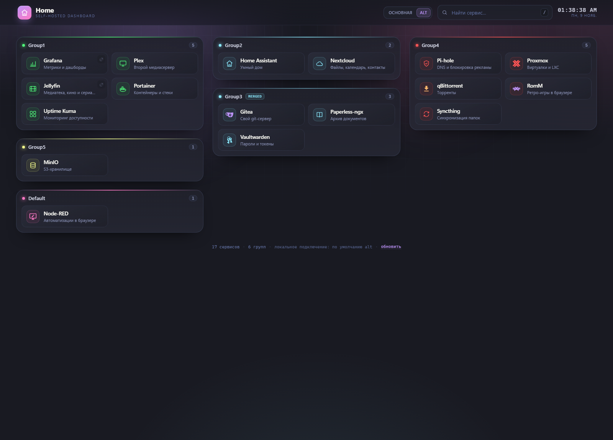

# Home — стартовая страница для своих сервисов

Локальный дашборд в духе [Homepage](https://github.com/gethomepage/homepage), но на Python
и в палитре [Dracula](https://draculatheme.com/contribute) (главный акцент — фиолетовый `#bd93f9`).



* конфиг — «TOML-like» файлы: `[system]`, `[group:Имя]`, `[service:Имя]`;
* группы строго по столбцам, объединение групп через `link`, приоритеты у групп и сервисов;
* сервер рендерит страницу целиком на каждый запрос — фронтенд не умеет запрашивать конфиг,
  он получает только готовый HTML (правим файл → F5 → видим изменения);
* свой поиск, часы, иконки SVG/PNG/JPG, локальные и внешние ссылки.

---

## Запуск

Нужен Python 3.10+ (проверено на 3.12).

Windows:

```bat
run.cmd
```

Linux/macOS:

```sh
./run.sh
```

`run.cmd`/`run.sh` сами создадут `.venv` и поставят зависимости. Вручную то же самое:

```sh
python -m venv .venv
.venv/Scripts/python -m pip install -r requirements.txt   # Windows
.venv/bin/python -m pip install -r requirements.txt       # Linux/macOS
.venv/Scripts/python app.py                               # http://localhost:8080
```

Полезные ключи: `--config путь/к/homepage.toml`, `--host 0.0.0.0`, `--port 8080`, `--debug`.
Переменные окружения: `HOMEPAGE_CONFIG`, `HOMEPAGE_HOST`, `HOMEPAGE_PORT`.

При старте процесс печатает одну строку: каким интерпретатором, из какой папки с кодом и с
каким конфигом он поднялся, — это первое, на что смотреть, если поведение не то.

Конфиг перечитывается на каждом запросе, а код — нет: после правки `*.py` или `git pull`
процесс надо перезапустить. Старый процесс с новым конфигом — обычная причина «странных»
предупреждений вроде «`'npm'` — известны portainer» или «лишние ключи fields»: конфиг уже
описывает типы, которых в запущенном коде ещё нет.

---

## Docker

Готовые `Dockerfile` и `docker-compose.yml`: в образе нет ни компилятора, ни pip, ни кэшей —
только Python, Flask, psutil (для виджетов `cpu`, `ram` и `disk`) и код (~62 МБ). psutil не выпускает
musllinux-колёс, поэтому на alpine он собирается из исходников: `gcc`, `musl-dev` и `linux-headers`
ставятся на время `pip install` и удаляются в том же слое — первая сборка идёт дольше, чем
пересборка кода. Если psutil всё же нет в образе, дашборд работает, а `cpu`/`ram`/`disk` показывают
ошибку «Not installed: psutil». В контейнере
`cpu` и `ram` показывают сам контейнер, а не хост: для цифр хоста нужен `--pid=host` и `/proc`
внутри, для дисков — те пути, что смонтированы.

```sh
docker compose up -d --build     # собрать и поднять на http://localhost:8080
docker compose logs -f
docker compose down
```

Папка `config/` монтируется с хоста (`./config:/app/config`), поэтому правка `*.toml`
подхватывается на следующем же запросе — перезапуск контейнера не нужен. Скачанные
`mdi:`/`sdi:`-иконки (`.icon-cache/`) тоже остаются на хосте.

Что можно поменять снаружи (переменные окружения):

| переменная | по умолчанию | что делает |
|---|---|---|
| `HOMEPAGE_PORT` | `8080` | порт на хосте (внутри контейнера всегда 8080) |
| `HOMEPAGE_BIND` | `0.0.0.0` | адрес, на котором слушать снаружи |
| `HOMEPAGE_CONFIG` | `/app/config/homepage.toml` | главный конфиг внутри контейнера |

```sh
HOMEPAGE_PORT=9000 HOMEPAGE_BIND=127.0.0.1 docker compose up -d
```

Контейнер работает под uid 1000 (пользователь `app`), чтобы `.icon-cache` в смонтированной
папке не принадлежал root. Если на хосте uid другой — раскомментируйте `user:` в compose.
Healthcheck ходит в `/healthz` стандартным питоном, поэтому curl/wget в образе не нужны.

Без compose:

```sh
docker build -t homepage .
docker run -d --name homepage -p 8080:8080 -v "$PWD/config:/app/config" homepage
```

Если конфиг лежит в другом месте — монтируйте его как есть: `-v /srv/homepage/config:/app/config:ro`.
На чтение тоже работает (страница не сломается), просто кэш иконок не сохранится между запусками.

---

## Конфиг

Главный файл — `config/homepage.toml`. Из него же читается `system.config_path`: все `*.toml`
из этой папки подтягиваются автоматически, раскладывать по файлам можно как угодно — в одном
только группы, в другом только сервисы, третий вообще один `[system]`.

Полный образец — `config/homepage.toml.example`: все секции, все ключи с дефолтами, все
одиннадцать типов виджетов и обе формы «виджета с другого хоста». Это не мёртвая справка:
файл валиден как есть, копируется в `config/homepage.toml` и работает; тест
`ExampleConfigTests` держит его таким (загружается без единой ошибки и предупреждения).

```toml
[system]
title = "Home"
icon_path = "icons"        # папка с иконками
config_path = "conf.d"     # папка (или список папок) с доп. конфигами
cols = 3                   # столбцов с группами на десктопе
mobile_cols = 1            # столбцов на мобильном
open_in_new_page = False   # значение по умолчанию для service.new_page
state_interval = 10        # как часто страница спрашивает /api/state, секунд (мин. 3)
group_cols = 3             # максимум столбцов карточек в группе; 0 — сколько влезет
# poll = 10                # старое имя state_interval, работает так же
```

### Сервисы

```toml
[service:Grafana]
link = "https://grafana.example.com"   # откроется по клику на карточку
alt = "http://192.168.1.10:3000"       # альтернативная (локальная) ссылка, опционально
name = "Grafana"                       # подпись; по умолчанию — имя секции
icon = "chart.svg"                     # файл из icon_path
icon_link = "https://…/logo.png"       # внешняя картинка; icon важнее
desc = "Метрики и дашборды"            # описание под названием
group = "Group1"                       # группа; без неё — Default
priority = 1                            # порядок внутри группы
new_page = true                         # открыть в новой вкладке (иначе — system.open_in_new_page)
```

| ключ | обяз. | смысл |
| --- | --- | --- |
| `link` | нет | основная ссылка карточки |
| `alt` | нет | локальная/альтернативная ссылка |
| `name` | нет | отображаемое имя, по умолчанию имя секции |
| `icon` | нет | файл внутри `system.icon_path`, URL или `mdi:`/`sdi:`-иконка |
| `icon_link` | нет | внешняя картинка, используется если `icon` не задан/не найден |
| `icon_color` | нет | цвет иконки (имя палитры или hex); по умолчанию — акцент группы |
| `desc` | нет | описание |
| `group` | нет | группа, по умолчанию `Default` (её можно не объявлять) |
| `priority` | нет | номер в списке группы; меньше — выше |
| `new_page` | нет | `true/false`; без значения наследует `system.open_in_new_page` |
| `widget` | нет | имена секций `[widget:…]` через запятую: `"sys, disk"` |
| `ping` | нет | `host` или `host:port` — точка статуса в правом краю карточки |

Без `link` и `alt` карточка никуда не ведёт: она отрисуется как обычно (имя, описание,
иконка, пинг, виджеты), но кликнуть по ней нельзя, и курсор над ней не превращается в палец.

### Группы

```toml
[group:Group3]
name = "Медиа"                 # подпись группы, по умолчанию — имя секции
priority = 2                    # это номер СТОЛБЦА (1 — самый левый)
link = "Group2"                 # объединить с другой группой (тот же столбец)
color = "pink"                  # акцент: имя палитры, #hex или «имя/#hex»
cols = 1                        # столбцов карточек в этой группе; иначе system.group_cols
```

| ключ | обяз. | смысл |
| --- | --- | --- |
| `name` | нет | подпись группы |
| `priority` | нет | номер столбца, в который группа попадает |
| `link` | нет | имя группы, с которой эту нужно объединить |
| `color` | нет | акцент группы (имя палитры, hex или `имя/#hex`); по умолчанию — по имени группы |
| `cols` | нет | сколько столбцов карточек допустить в группе; без ключа — `system.group_cols`, `0` — сколько поместится |

Группа, на которую никто не ссылается и которая упомянута только в сервисах, создаётся сама.
Группа без сервисов тоже рисуется — с подписью «здесь пока пусто».

### Шапка — `[header]`

Всё, что относится к верхней панели, живёт в отдельной секции (те же ключи можно писать
и в `[system]` — они всё равно про шапку).

```toml
[header]
show = true              # вся шапка целиком; в [system] то же самое: header = true
desc = "мои сервисы"    # подпись под заголовком (по умолчанию «self-hosted dashboard»)
time = true              # часы
time_format = 12         # 12 — AM/PM, 24 — 24-часовой
search = true            # строка поиска
icon = "home.svg"        # логотип в шапке, путь относительно system.icon_path (можно mdi:/sdi:)
favicon = "favicon.svg"  # иконка вкладки, тоже относительно system.icon_path
link_mode = "auto"       # auto | main | alt — какая ссылка открывается по умолчанию
```

| ключ | дефолт | что делает |
|---|---|---|
| `show` (он же `header`, `enabled`) | `true` | убрать шапку целиком — останется только сетка групп |
| `desc` (он же `tagline`, `subtitle`) | `self-hosted dashboard` | подпись под заголовком; `desc = ""` убирает её совсем |
| `time` | `true` | часы; `time_format = 12` даёт AM/PM (`01:17:01 AM`), `24` — `01:17:01` |
| `search` | `true` | строка поиска вместе с горячей клавишей `/` |
| `icon` | нет | логотип: файл из `icon_path` (svg вставляется инлайном), `mdi:`/`sdi:` или URL |
| `favicon` | нет | иконка вкладки; показывается как есть или как `data:`-URI для svg |
| `link_mode` (он же `main_alt`) | `auto` | `auto` — по адресу подключения (см. ниже), `main` — всегда `link`, `alt` — всегда `alt` |

Название выбрано так, чтобы совпадать с переключателем в шапке: это его режим по умолчанию,
а не «жёсткий» запрет — нажать кнопку в браузере всё равно можно. `auto` воспроизводит
старое поведение: локальное подключение → `alt`, внешнее → основная.

---

### Как раскладываются столбцы

* `priority` группы — это номер столбца: `1` — левый, дальше вправо.
  Если приоритет больше числа столбцов, он заворачивается по кругу (`priority = 4` при `cols = 3` → столбец 1).
* Группы без приоритета встают в столбцы слева направо и при переполнении продолжают
  с первого столбца, снизу, не пересекаясь с соседями.
* Одинаковые (или отсутствующие) приоритеты сортируются по имени — и у групп, и у сервисов.
* Сколько столбцов карточек допускается внутри группы, решает `system.group_cols`
  (по умолчанию 3, `0` — сколько поместится), а `cols` у самой группы переопределяет это
  для неё одной: `cols = 1` даёт одну колонку, `cols = 2` — две. Предел — не жёсткая сетка:
  на узком экране карточки всё равно складываются в одну колонку.
* `link` у группы — единственное исключение из правила «одна группа — один столбец»:
  объединённая группа живёт в столбце основной и стоит сразу под ней. Ссылки можно
  выстраивать в цепочку (`A → B → C`), циклы не ломают страницу.
* **На узком экране** (≤ 900px) столбцы перестают командовать порядком: обёртки-колонки
  «растворяются», а группы идут единым потоком в порядке приоритетов —
  `Group1, Group2, Group3, Group4, Group5, Default`, объединённая сразу за своей основной.
  `mobile_cols` задаёт, во сколько столбцов этот поток раскладывается (по умолчанию 1),
  заполняется он так же — слева направо, строками. Так `cols = 3` больше не превращает
  мобильную версию в набор столбцов, идущих друг за другом.

Сколько карточек встаёт в строку, решает не только `group_cols`, но и ширина полосы и
минимум ширины карточки (180px): на экране 1920 при `cols = 3` полоса группы — 560px, и три
карточки по 181px в неё влезают; на 1600 — две по 222px, на 1280 — одна. Карточка уже 190px
считает поля виджетов мельче (12.5px, а четыре поля — 11px), поэтому «19.3 GiB» в ней ещё
читается. Три длинных значения подряд (`free, consumed, total` диска в GiB) в 181px влезают
впритык: если нужен запас — `cols = 2` у группы (карточки по 287px) или два поля вместо трёх.

Пример, который лежит в `config/` (группы 2 и 3 объединены):

```
Group1  -  Group2  -  Group4
Site1   -  Site1   -  Site1
Site2   -  Site2   -  Site2
Site3   -  Group3  -  Site3
Site4   -  Site1   -  Site4
Site5   -  Site2   -  Site5
        -  Site3   -
Group5  -          -
Site1   -          -
```

### Прочее

* Порядок применения `[system]` и `[header]`: сначала доп. файлы по алфавиту, последним —
  главный конфиг, то есть главный конфиг всегда побеждает (второй `[header]` в другом файле
  дополняет первый, а не затирает его целиком).
* Относительные пути (`icon_path`, `config_path`) считаются от файла, в котором написаны;
  в `config_path` можно указывать маску (`"../shared/*.toml"`).
* Ошибки и предупреждения разбора не роняют страницу: они показываются плашками сверху,
  а всё корректное продолжает работать.

---

## Иконки

`icon` умеет три вида источника (приоритет — сверху вниз, `icon` всегда важнее `icon_link`):

```toml
[service:Gitea]
icon = "code.svg"            # файл из system.icon_path — svg вставляется инлайном
icon_color = purple          # цвет иконки; без него берётся акцент группы

[service:Proxmox]
icon = "sdi:proxmox"         # Iconify: sdi = Simple Icons

[service:qBittorrent]
icon = "mdi:download"       # mdi (Material Design Icons) и любой набор Iconify
icon_color = orange

[service:RomM]
icon_link = "https://…"      # внешняя картинка
```

* Локальный SVG вставляется в HTML инлайном и красится в `icon_color` (или в акцент группы),
  поэтому hover-эффекты работают как у остальных элементов; PNG/JPG/WebP отдаются через `/icon/<имя>`
  (только из `icon_path`, выход за папку запрещён).
* `mdi:` / `sdi:` (и вообще `набор:имя`) сервер один раз скачивает с Iconify, кладёт в
  `.icon-cache/` рядом с конфигом и дальше работает без сети. Если сети нет и кэша нет —
  карточка берёт `icon_link`, а если и его нет — плейсхолдер с первой буквой.
* Кэш можно чистить руками: `rm -rf config/.icon-cache` (папка в `.gitignore`).
* Ничего не задано (или файл не найден) — плейсхолдер.

В `config/icons/` лежат 16 демонстрационных SVG — их можно заменить своими.

---

## `link` и `alt`

У каждой карточки может быть два адреса: `link` (основной) и `alt` (резервный — обычно локальный,
если основной внешний). Обе ссылки попадают в готовую страницу, и в шапке есть переключатель
**основная / alt** — он меняет, куда ведёт клик по карточке; у сервиса с одной ссылкой клик всегда
ведёт на неё. Выбор запоминается в браузере (`localStorage`), разово его можно задать в адресе:
`/?links=main` или `/?links=alt`.

Пока переключатель не трогали, действует правило по умолчанию, и его задаёт `[header] link_mode`:
`main` — всегда `link`, `alt` — всегда `alt`, `auto` (дефолт) — по адресу подключения: если страница
открыта с локального адреса (`localhost`, `127.0.0.1`, `192.168.*`, `10.*`, `nas` — любой приватный
или односоставный хост), карточка ведёт на `alt`, с внешнего адреса — на `link`. Режим задаёт
и серверную ссылку в HTML, так что работает даже при выключенной шапке (`show = false`). Подвал подсказывает, какой режим выбран сервером.

Кнопка со стрелочкой в углу карточки всегда открывает вторую ссылку — ту, что не выбрана сейчас,
и её подсказка каждый раз описывает именно тот адрес, на который она ведёт: в режиме `main`
это `alt` (обычно локальный), в режиме `alt` — `link` (обычно внешний).

---

## Виджеты и пинг

Внутри карточки можно показать живое состояние сервиса. Источники описаны секциями
`[widget:имя]`, а карточка подключает их двумя строками — `widget` (до четырёх полей)
и `ping` (точка в правом краю карточки). Виджетов у карточки бывает несколько:
`widget = "sys, disk"` — каждый следующий рисуется под предыдущим, со своей полосочкой. Браузер по-прежнему не видит конфигов: сервер сам
опрашивает источники, кэширует ответы и отдаёт готовые числа на `/api/state`, а страница раз
в `state_interval` секунд (по умолчанию 10, минимум 3; старое имя ключа — `poll`)
перерисовывает карточки. Вкладка в фоне сервер не
опрашивает, а после двух неудачных запросов подряд значения гаснут и помечаются устаревшими.

```toml
[system]
state_interval = 10            # как часто клиент спрашивает /api/state, секунд

[widget:portainer]             # внутреннее имя: на него ссылается service.widget
type = "portainer"             # тип: что и как спрашивать
url = "https://192.168.0.112:9000"
env = 1                        # номер окружения (endpoint) в Portainer
key = "${PORTAINER_KEY}"      # секрет из окружения, а не из репозитория
verify_tls = false             # по умолчанию самоподписанный сертификат принимается
fields = "running, stopped, total"   # какие поля и в каком порядке

[service:Portainer]
link = "https://192.168.0.112:9000"
group = "Group1"
widget = "portainer"           # три поля: running / stopped / total
ping = "192.168.0.112:9000"    # точка статуса; хост и порт, порт по умолчанию 443
ping_timeout = 2               # секунд на попытку, по умолчанию 2
```

| ключ карточки | смысл |
| --- | --- |
| `widget` | имена секций `[widget:…]` через запятую; без неё — пусто |
| `ping` | `host` или `host:port`, TCP-подключение к сервису |
| `ping_timeout` | таймаут одного пинга в секундах |

Ключи `[widget:…]`: `type` — тип источника, плюс то, что этот тип требует (см. таблицу ниже),
`fields` — какие поля показывать и в каком порядке, и общие для всех `timeout` и `verify_tls`.
Любое значение можно взять из окружения — `${VAR}` или `${VAR:-запасное}`, как в compose:
в репозиторий секрет не попадает. Всё чувствительное — логины, пароли, токены — вынесено
в `config/.env`: файл читается при старте, в git не входит, а уже заданное окружение главнее
его. Образец со всеми именами — `config/.env.example`.

| переменная | для чего |
| --- | --- |
| `PORTAINER_KEY` | API-ключ Portainer (My account → Access tokens) |
| `ADGUARD_USERNAME`, `ADGUARD_PASSWORD` | вход в AdGuard Home |
| `NPM_USERNAME`, `NPM_PASSWORD` | вход в Nginx Proxy Manager (e-mail и пароль) |
| `CHANGEDETECTION_KEY` | API-ключ changedetection.io (Settings → API) |
| `WATCHTOWER_KEY` | `WATCHTOWER_HTTP_API_TOKEN` |
| `YOURSPOTIFY_URL`, `YOURSPOTIFY_KEY` | адрес API Your Spotify и ключ пользователя | Кэш: поля — 10 секунд, пинги — 5; `GET /api/state?cached=1` отдаёт
только то, что уже в кэше, совсем без сетевых попыток. `GET /api/widget?id=имя`
отдаёт один виджет — для дашборда на другом хосте (см. «Виджет с другого хоста»).

Что умеют типы:

| `type` | что спрашивает | обязательные ключи | поля (по умолчанию) |
| --- | --- | --- | --- |
| `portainer` | контейнеры Docker через API Portainer | `url`, `key` (+`env`) | `running`, `stopped`, `total` |
| `adguard` | `/control/stats` у AdGuard Home | `url` (+`username`, `password`) | `queries`, `blocked`, `filtered`, `latency` |
| `npm` | `/api/nginx/proxy-hosts` у Nginx Proxy Manager | `url`, `username`, `password` | `enabled`, `disabled`, `total` |
| `minecraft` | протокол статуса по UDP | `url` (`host:port` или `udp://host:port`) | `status`, `players`, `version` |
| `changedetectionio` | `/api/v1/watch` | `url`, `key` | `diffsDetected`, `totalObserved` |
| `uptimekuma` | `/api/status-page[/heartbeat]/{slug}` | `url`, `slug` | `up`, `down`, `uptime`, `incident` |
| `yourspotify` | `/spotify/{songs,time,different_artists}_per` | `url`, `key` (+`interval`) | `songs`, `time`, `artists` |
| `watchtower` | `/v1/metrics` (prometheus-текст) | `url`, `key` | `containers_scanned`, `containers_updated`, `containers_failed` |
| `cpu` | сам хост: загрузка CPU, температура, аптайм | нет (+`tempmin`, `tempmax`, `units`) | `cpu`, `cputemp`, `uptime` |
| `ram` | сам хост: оперативная память | нет (+`ramunits`) | `free`, `consumed`, `total` |
| `disk` | свободное место по путям | `disk` (+`diskunits`, `name`) | `free`, `consumed`, `total` |
| любой из них | не здесь, а на соседнем dashboard | `host` (+`external`) | те же, что у типа |

`fields` перечисляет поля в том порядке, в каком они встанут в карточку, и может выбросить
лишнее — строкой: `fields = "total, disabled, enabled"` даст «всего, выключено, включено».
Старая запись списком (`fields = ["total", "disabled", "enabled"]`) значит ровно то же самое.
В карточку влезает не больше четырёх полей, поэтому прописанное дальше просто отбрасывается
с конца; опечатка в имени поля страницу не ломает — в конфиг-предупреждениях будет сказано,
какое имя неизвестно и какие есть.
`yourspotify` понимает `interval` (`day`, `week`, `month`, `year`, `all`; по умолчанию `week`),
`npm` помнит выданный токен час, чтобы не логиниться на каждый опрос.

### Хост и диски, полосочка статуса

```toml
[service:ThisHost]
icon = "mdi:server"
desc = "Этот хост"
group = "Group1"
widget = "cpu, ram, disk"      # виджетов несколько: каждый следующий — под предыдущим

[widget:cpu]
type = cpu
fields = "cpu, cputemp, uptime"
tempmin = 20                   # шкала температуры: ниже — зелёная, выше tempmax — красная
tempmax = 90
units = metric                 # metric (по умолчанию) или imperial — только для температуры

[widget:ram]
type = ram
fields = "free, consumed, total"
ramunits = bytes               # bytes — 1.5 GB (1000), bbytes — 1.4 GiB (1024)

[widget:disk]
type = disk
name = "C:, D:"               # подпись; без неё диск подписан сам, коротко: C: · D:
disk = "C:\, D:\"              # пути как есть; на linux — /, /mnt/data, можно несколько
diskunits = bytes              # bytes — 1.5 GB (1000), bbytes — 1.4 GiB (1024)
fields = "free, consumed, total"
```

`cpu`, `ram` и `disk` смотрят на тот же хост, где живёт dashboard (в контейнере — на
контейнер), описаны в `hp/widgets.py`, `hp/thermal.py`. Старое имя `type = sysinfo`
продолжает работать и означает `cpu` (поле `memory` ушло в `ram`). Несколько путей
в `disk` складываются в одно число, `name` даёт виджету подпись — она нужна, когда на
одной карточке два диска и надо их различить. Без `name` подпись у диска всё равно есть:
пути, сжатые до одного-двух шагов (`/` → `/`, `C:\Program Files` → `C:/Program Files`,
`/var/lib/docker` → `…/lib/docker`, больше двух путей — `+1`), так что строка
`disk = "/, /data"` уже читается на карточке без единого лишнего ключа.

**Температура CPU** — единственная цифра, которой не хватает psutil на всех системах:

* linux — `psutil.sensors_temperatures()` (hwmon: `coretemp`, `k10temp`, `zenpower`…),
  затем `/sys/class/thermal/thermal_zone*/temp` и `/sys/class/hwmon/hwmon*/temp*_input`
  напрямую — так датчик виден и в контейнере, если `/sys` смонтирован;
* windows — только WMI: поставь и запусти [LibreHardwareMonitor](https://github.com/LibreHardwareMonitor/LibreHardwareMonitor)
  (или OpenHardwareMonitor) хотя бы свёрнутым — он публикует `root/LibreHardwareMonitor`,
  откуда берётся «CPU Package»/«Tctl/Tdie». Без него остаётся `MSAcpi_ThermalZoneTemperature`,
  а он есть не на всех платах — тогда `cputemp` покажет прочерк, а не выдуманное число.
  Опрос идёт через `powershell`, поэтому результат кэшируется на 15 секунд.

**Загрузка CPU** считается не одним мгновенным замером, а по своим замерам за окно:
пока окно короче трёх секунд, полоска бы дёргалась; реальный опрос идёт раз в 10 секунд,
и цифра становится средним за эти 10. От частоты опроса результат не зависит: замеры
копятся в одном месте на весь процесс, поэтому дело не в том, какая вкладка и какой
поток спросили. (`psutil.cpu_percent(interval=None)` для этого не годится — он помнит
предыдущий замер только для своего потока, и в чужом потоке возвращает 0 % или 100 %.)

У `cpu`, `ram` и `disk` снизу — тонкая полосочка во всю ширину виджета: у `cpu` её
длина — загрузка, а цвет — худшее из загрузки и температуры по шкале `tempmin`…`tempmax`
(датчика нет — смотрим только загрузку); у `ram` и `disk` — заполненность. Цвет общий
для всех: до 70% — зелёный, до 90% — жёлтый, дальше — красный; на ошибке полосочка
исчезает вместе с цифрами.

Точка статуса: зелёная — сервис ответил быстрее 350 мс, жёлтая — ответил, но медленнее,
красная — не ответил, серая — ещё не спрашивали. У полей четыре цвета значений: нейтральный,
спокойный (`running`, `up`), тревожный (`stopped`, `failed`) и предупреждающий
(`blocked` у AdGuard, неполный аптайм). Подписи полей — по-английски, как и служебные
тексты: русский остался только там, где говорит сама страница («обновить», поиск).

Если сервис недоступен, в полях карточки стоят кресты (старые цифры не выдаются за свежие),
а причина — в подсказке при наведении на полосу полей; курсор при этом не меняется:
«Port closed.», «No response.», «Host unreachable.», «Access denied: HTTP 403.»,
«Not configured: missing slug.».
Служебные тексты — по-английски: так их читают и логи, и человек. Адресов и кодов ОС
в подсказке нет — клиенту незачем знать, куда стучится сервер (так же, как у точки ping).
Пока данных ещё не было вовсе, в полях прочерки. Страница при этом живёт дальше.

Подсказки свои, а не браузерные: текст лежит в `data-tip`, всплывает через 90 мс
(родная подсказка ждёт почти секунду), встаёт над элементом и не вылезает за край окна.
Так же работают точка ping, кнопка второй ссылки, имена и подписи полей.
Демо-карточки всех одиннадцати типов лежат в `config/conf.d/widgets.toml`;
секреты там взяты из окружения, и без переменной карточка показывает ошибку конфига,
а не ломает страницу.

### Виджет с другого хоста

Тот же дашборд, поднятый на другом хосте, умеет отдать один свой виджет — и тогда
его можно показать здесь, с подписью и единицами, которых хочется здесь:

```toml
[service:Nightly]
link = "http://192.168.0.112:24556"
desc = "диск с другой машины"
group = "Group1"
widget = "nas"

[widget:nas]
type = disk                  # можно и не писать: тип возьмётся из ответа
external = "disk"            # имя секции [widget:disk] на том дашборде
host = "192.168.0.112:24556" # его адрес; без http:// — добавится сам
name = "NAS"                 # подпись своя, соседняя не важна
diskunits = bbytes           # и единицы свои
fields = ["free", "consumed", "total"]
```

Сосед отдаёт `GET /api/widget?id=disk` — готовые поля и сырые значения; страница
берёт числа из `values` и рисует их своими `type`/`fields`/`diskunits`/`tempmin`.
Поэтому одна и та же цифра здесь будет в GiB, а у соседа в GB, и `name` с этой
стороны главнее. Если `type` не указан, тип берётся у соседа; если `external`
не указан или такого имени у соседа нет, спрашивается виджет того же типа, затем
с тем же именем секции. Обязательные ключи типа (`disk` у диска) на этой стороне
тогда не нужны — данные уже прочитаны там.

Что нужно с другой стороны: такая же версия дашборда (с `/api/widget`) и открытый
порт; авторизации у дашборда нет, так что адрес виджетов виден тому, кто до него
дотянется, — как и сама страница. Недоступный сосед — обычная ошибка виджета:
кресты и одна фраза («Port closed.»), а не пустая карточка. Адреса соседа в
браузере нет вовсе: ни в подсказке, ни в `/api/state` — туда уходит только
«from another dashboard», и куда именно ходит сервер, знает только он сам.
`timeout` (секунды) — свой ключ этого виджета, по умолчанию 4.

---

## Как это работает

```
GET / ──► чтение всех конфигов ──► сборка layout ──► Jinja-шаблон ──► готовый HTML
```

* Конфиг перечитывается **на каждый** запрос; браузер никогда не видит содержимое конфигов,
  только отрендеренную страницу и числа на `/api/state` — их сервер сам добывает из виджетов.
* JS (`static/js/app.js`) работает уже по готовому DOM: поиск, часы, подмена битых картинок
  и поллинг `/api/state` для пингов и виджетов.
* Порядок «столбцы → группы → сервисы» считается в `hp/layout.py` на чистом Python,
  поэтому его легко проверить тестами без браузера.

```
app.py              Flask: маршруты /, /api/state, /icon/<name>, /healthz
hp/config.py        парсер TOML-like и сборка модели (Site, Group, Service, System)
hp/layout.py        столбцы, приоритеты, объединение групп, выбор link/alt
hp/widgets.py       источники живого состояния: portainer, cpu, ram, disk, пинг и кэш ответов
hp/thermal.py       температура CPU: hwmon и sysfs на linux, WMI и LHM на Windows
hp/icons.py         иконки: файлы, mdi/sdi через Iconify, /icon/…, плейсхолдер
hp/colors.py        палитра Dracula, разбор имён/hex и автоподбор акцента группы
templates/          index.html, error.html
static/             style.css (Dracula), app.js, favicon.svg
config/             homepage.toml + conf.d/* + icons/
tests/              unittest: парсер, раскладка, HTTP-поведение
Dockerfile          образ: alpine + venv без pip, пользователь app (uid 1000)
docker-compose.yml  запуск с маунтом ./config:/app/config
.dockerignore       что не тащить в контекст сборки
```

---

## Тесты

```sh
.venv/Scripts/python -m unittest discover -s tests -t .
```

96 тестов: разбор значений и секций, склейка конфигов, приоритеты и переносы столбцов,
объединение групп (включая цепочки и циклы), сортировка сервисов, наследование `new_page`,
выбор `link`/`alt` и переключатель режима, цвета групп и иконок, `mdi:`/`sdi:` (с подменой
загрузки), отдача страницы, защита `/icon/`, перечитывание конфига на каждом запросе,
виджеты и пинги: разбор `[widget:…]`, подстановка `${VAR}`, счёт контейнеров Portainer
на подставном HTTP-сервере, TCP-пинг, TTL кэша, `/api/state` с `cached=1` и разметка
полей и точки в карточке.

---

## Заметки

* Для доступа из локальной сети сервер по умолчанию слушает `0.0.0.0`; для «только этот компьютер»
  запускайте с `--host 127.0.0.1`.
* `app.run` — это dev-сервер. Для постоянной работы: `pip install waitress` и
  `waitress-serve --listen=0.0.0.0:8080 app:app`.
* Страница отдаётся с `Cache-Control: no-store`, так что F5 всегда показывает свежий конфиг.
